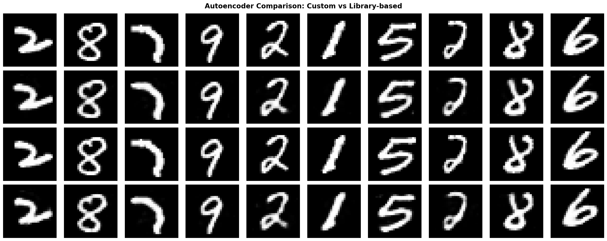
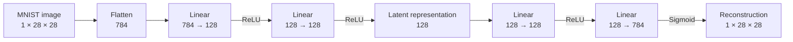
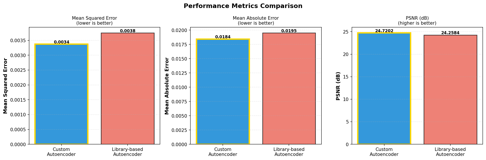

# MNIST Autoencoders in PyTorch

[](https://www.python.org/)
[](https://pytorch.org/)
[](http://yann.lecun.com/exdb/mnist/)
[](LICENSE)

An educational image-reconstruction project that trains and compares two fully connected autoencoders on MNIST. The models have the same architecture and parameter count, but express it in two PyTorch styles:

- **Custom autoencoder** — layers are declared individually and the forward pass is written explicitly.
- **Sequential autoencoder** — the encoder and decoder are composed with `torch.nn.Sequential`.

The repository includes training and evaluation scripts, reconstruction samples, metric plots, and machine-readable results.



## Architecture

Each 28 × 28 grayscale image is flattened to 784 values. Both implementations then use the following network:



Both models contain **234,640 trainable parameters**. They optimize mean squared reconstruction error with Adam; digit labels are not used.

## Recorded results

The committed results were produced on the 12,000-image test portion of a seeded 60/20/20 split of the 60,000-image MNIST training set.

| Metric | Custom `nn.Module` | `nn.Sequential` | Better recorded value |
|---|---:|---:|---|
| MSE ↓ | **0.003373** | 0.003751 | Custom |
| MAE ↓ | **0.018430** | 0.019515 | Custom |
| PSNR ↑ | **24.72 dB** | 24.26 dB | Custom |
| Inference time ↓ | 0.5292 s | **0.4375 s** | Sequential |
| Test samples | 12,000 | 12,000 | — |



These values document one run, not a controlled performance benchmark. The scripts seed the dataset split, but not model initialization or every runtime source of variation; inference time also depends on hardware and system load. Since the two models perform the same mathematical operations, differences should not be attributed to the API style alone.

Detailed results are available in [`outputs/IMPLEMENTATION_DETAILS.md`](outputs/IMPLEMENTATION_DETAILS.md), while [`outputs/metrics.json`](outputs/metrics.json) contains the raw metrics.

## Getting started

### Prerequisites

- Python 3
- `pip`
- Optional: a CUDA-capable GPU supported by your PyTorch installation

### Installation

Clone the repository and create an isolated environment:

```bash
git clone https://github.com/praniil/autoencoder-pytorch.git
cd autoencoder-pytorch

python3 -m venv .venv
source .venv/bin/activate
python3 -m pip install --upgrade pip
python3 -m pip install torch torchvision matplotlib numpy
```

For CUDA, install the appropriate PyTorch build using the command generated at [pytorch.org/get-started](https://pytorch.org/get-started/locally/) instead of the generic `pip` command above.

## Usage

The scripts currently use paths relative to `src/`, so run them from that directory:

```bash
cd src
```

### 1. Train the explicit autoencoder

```bash
python3 train_autoencoder.py
```

This downloads MNIST when necessary, trains with early stopping, and writes the weights to `../trained-autoencoder`.

### 2. Train the sequential autoencoder

```bash
python3 library_autoencoder.py
```

The best validation checkpoint is written to `../trained-library-autoencoder`.

### 3. Compare both models

```bash
python3 compare_autoencoders.py
```

The comparison loads both checkpoints, evaluates 12,000 test images, and regenerates the plots and reports in `outputs/`. If the sequential checkpoint is missing, this script trains it automatically. The custom checkpoint must already exist.

### 4. Inspect custom reconstructions

```bash
python3 test_custom_output.py
```

This writes `outputs/custom_autoencoder_test.png`. To open an interactive Matplotlib window instead, run `python3 test_autoencoder.py` in a graphical environment.

Training defaults are defined directly in the scripts:

| Setting | Value |
|---|---:|
| Maximum epochs | 100 |
| Batch size | 128 |
| Learning rate | 0.001 |
| Optimizer | Adam |
| Loss | Mean squared error |
| Early-stopping patience | 3 epochs |
| Dataset split | 60% train / 20% validation / 20% test |

CUDA is selected automatically when `torch.cuda.is_available()` is true; otherwise the scripts use the CPU.

## Project structure

```text
autoencoder-pytorch/
├── src/
│   ├── autoencoder.py           # Explicit nn.Module model
│   ├── train_autoencoder.py     # Custom model training and data split
│   ├── library_autoencoder.py   # Sequential model and training routine
│   ├── compare_autoencoders.py  # Evaluation, metrics, plots, and reports
│   ├── test_autoencoder.py      # Interactive reconstruction display
│   └── test_custom_output.py    # Saved custom reconstruction plot
├── outputs/
│   ├── IMPLEMENTATION_DETAILS.md
│   ├── metrics.json
│   ├── comparison_report.txt
│   └── *.png                    # Reconstruction and metric plots
├── LICENSE
└── README.md
```

The downloaded `mnist_dataset/` directory and trained checkpoint files are created one level above `src/` and are intentionally not required to browse the committed results.

## How the comparison works

1. MNIST is converted to tensors and deterministically split with seed `42`.
2. Images are flattened from `[batch, 1, 28, 28]` to `[batch, 784]`.
3. Each model reconstructs pixel intensities in the `[0, 1]` range.
4. Reconstruction quality is measured with MSE, MAE, and PSNR.
5. Sample reconstructions, a metric chart, a text report, and JSON metrics are written to `outputs/`.

## License

This project is available under the [MIT License](LICENSE).
