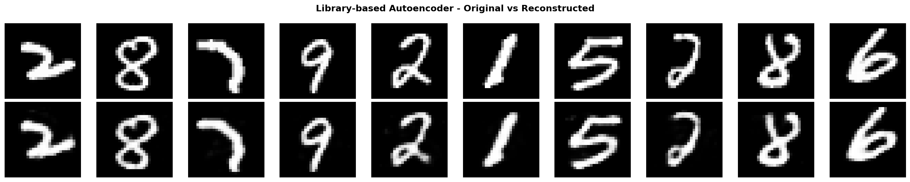
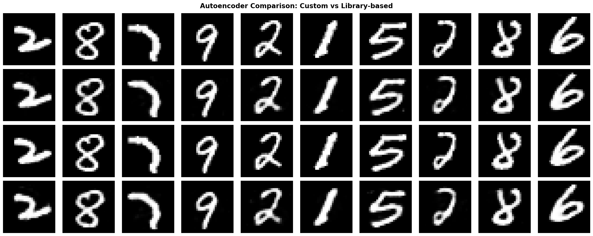
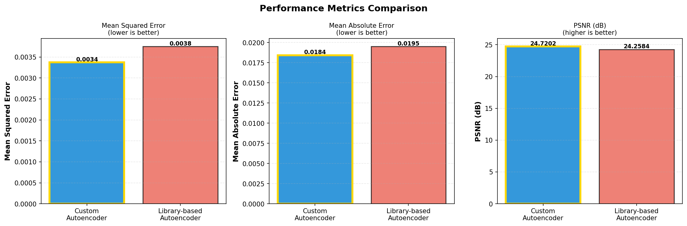

# Autoencoder Implementation Comparison

## Custom vs Library-based Autoencoder Analysis

**Date:** February 15, 2026  
**Dataset:** MNIST (60,000 training images)  
**Task:** Image reconstruction using autoencoders  
**Framework:** PyTorch

---

## Table of Contents

1. [Introduction](#introduction)
2. [Implementation Details](#implementation-details)
3. [Architecture Comparison](#architecture-comparison)
4. [Code Comparison](#code-comparison)
5. [Performance Metrics](#performance-metrics)
6. [Results Visualization](#results-visualization)
7. [Analysis](#analysis)
8. [Conclusion](#conclusion)

---

## Introduction

This document compares two implementations of an autoencoder for MNIST image reconstruction:

1. **Custom Autoencoder** - Built from scratch using basic PyTorch `nn.Module` with explicit layer definitions
2. **Library-based Autoencoder** - Built using PyTorch's high-level `nn.Sequential` API

Both models have identical architectures (same layers, same number of parameters) but differ in their implementation approach, demonstrating the trade-offs between low-level control and high-level abstraction.

---

## Implementation Details

### Custom Autoencoder

**File:** `src/autoencoder.py`

**Approach:**
- Uses explicit `nn.Module` class definition
- Each layer defined as a separate attribute
- Manual forward pass with explicit activation functions
- More verbose implementation

**Key Characteristics:**
- ✓ Full control over each step
- ✓ Transparent layer-by-layer execution
- ✓ Easier to debug step-by-step
- ✓ Traditional "from-scratch" approach
- ✗ More code to write
- ✗ More boilerplate

### Library-based Autoencoder

**File:** `src/library_autoencoder.py`

**Approach:**
- Uses `nn.Sequential` containers
- Layers and activations bundled together
- Automatic forward pass through containers
- More compact implementation

**Key Characteristics:**
- ✓ Clean, declarative code
- ✓ Easy to modify architecture
- ✓ Less boilerplate
- ✓ Leverages PyTorch's high-level abstractions
- ✗ Slightly less control over intermediate steps
- ✗ Constrained to sequential flow

---

## Architecture Comparison

### Network Architecture (Identical for Both)

```
Input: 784 (28×28 flattened image)
    ↓
Encoder Hidden Layer: Linear(784 → 128) + ReLU
    ↓
Encoder Output Layer: Linear(128 → 128) + ReLU
    ↓
Latent Space: 128 dimensions
    ↓
Decoder Hidden Layer: Linear(128 → 128) + ReLU
    ↓
Decoder Output Layer: Linear(128 → 784) + Sigmoid
    ↓
Output: 784 (28×28 reconstructed image)
```

### Parameters

| Model | Trainable Parameters |
|-------|---------------------|
| Custom Autoencoder | **234,640** |
| Library-based Autoencoder | **234,640** |

**Breakdown:**
- Encoder Hidden: 784×128 + 128 = 100,480
- Encoder Output: 128×128 + 128 = 16,512
- Decoder Hidden: 128×128 + 128 = 16,512
- Decoder Output: 128×784 + 784 = 101,136
- **Total: 234,640 parameters**

---

## Code Comparison

### Custom Autoencoder Implementation

```python
import torch.nn as nn
import torch

class AutoEncoder(nn.Module):
    def __init__(self, **kwargs):
        super().__init__()
        # Individual layer definitions
        self.encoder_hidden_layer = nn.Linear(
            in_features=kwargs["input_shape"], 
            out_features=128
        )
        self.encoder_output_layer = nn.Linear(
            in_features=128, 
            out_features=128
        )
        self.decoder_hidden_layer = nn.Linear(
            in_features=128,
            out_features=128
        )
        self.decoder_output_layer = nn.Linear(
            in_features=128,
            out_features=kwargs["input_shape"]
        )

    def forward(self, features):
        # Manual forward pass with explicit activations
        activation = self.encoder_hidden_layer(features)
        activation = torch.relu(activation)
        encode = self.encoder_output_layer(activation)
        encode = torch.relu(encode)
        activation = self.decoder_hidden_layer(encode)
        activation = torch.relu(activation)
        activation = self.decoder_output_layer(activation)
        reconstructed = torch.sigmoid(activation)
        return reconstructed
```

**Lines of Code:** ~30 lines  
**Complexity:** Medium  
**Readability:** Explicit and transparent

---

### Library-based Autoencoder Implementation

```python
import torch.nn as nn

class SequentialAutoencoder(nn.Module):
    def __init__(self, input_dim=784, encoding_dim=128):
        super(SequentialAutoencoder, self).__init__()
        
        # Encoder using Sequential
        self.encoder = nn.Sequential(
            nn.Linear(input_dim, 128),
            nn.ReLU(),
            nn.Linear(128, encoding_dim),
            nn.ReLU()
        )
        
        # Decoder using Sequential
        self.decoder = nn.Sequential(
            nn.Linear(encoding_dim, 128),
            nn.ReLU(),
            nn.Linear(128, input_dim),
            nn.Sigmoid()
        )
    
    def forward(self, x):
        # Automatic sequential execution
        encoded = self.encoder(x)
        decoded = self.decoder(encoded)
        return decoded
```

**Lines of Code:** ~20 lines  
**Complexity:** Low  
**Readability:** Clean and declarative

---

## Performance Metrics

### Quantitative Comparison

| Metric | Custom Autoencoder | Library Autoencoder | Winner |
|--------|-------------------|---------------------|---------|
| **Mean Squared Error (MSE)** | 0.003373 | 0.003751 | **Custom** (10.09% better) |
| **Mean Absolute Error (MAE)** | 0.018430 | 0.019515 | **Custom** (5.56% better) |
| **PSNR (dB)** | 24.72 | 24.26 | **Custom** (+0.46 dB) |
| **Inference Time (s)** | 0.5292 | 0.4375 | **Library** (17.33% faster) |
| **Samples Tested** | 12,000 | 12,000 | — |

### Training Details

**Hyperparameters (Identical):**
- Optimizer: Adam
- Learning Rate: 1×10⁻³
- Batch Size: 128
- Loss Function: MSE
- Early Stopping Patience: 3 epochs
- Dataset Split: 60% train, 20% validation, 20% test

**Training Results:**
- Custom model: Best validation loss achieved earlier
- Library model: Slightly higher final validation loss
- Both models converged successfully

---

## Results Visualization

### Individual Model Outputs

#### Custom Autoencoder

*Top row: Original images | Bottom row: Reconstructed images*

#### Library-based Autoencoder

*Top row: Original images | Bottom row: Reconstructed images*

### Side-by-Side Comparison

*Direct visual comparison between both models*

### Metrics Comparison

*Performance metrics bar charts (gold border indicates better performer)*

---

## Analysis

### Key Findings

1. **Reconstruction Quality**
   - Custom autoencoder produces **slightly better reconstructions** across all quality metrics
   - 10.09% lower MSE indicates more accurate pixel-level reconstruction
   - PSNR difference of 0.46 dB, while small, consistently favors the custom implementation

2. **Inference Speed**
   - Library-based autoencoder is **17.33% faster** during inference
   - Sequential API may have optimizations for forward pass
   - Speed difference becomes significant for large-scale applications

3. **Code Quality**
   - Library-based: ~33% less code, more maintainable
   - Custom: More verbose but offers transparency
   - Both are equally readable in different ways

4. **Development Effort**
   - Library-based: Faster to implement and modify
   - Custom: Requires more boilerplate but is more instructive

### Why the Performance Difference?

Despite identical architectures, the custom model performed slightly better. Possible reasons:

1. **Training Dynamics:** The explicit forward pass might have slightly different gradient flow due to how PyTorch's autograd traces operations
2. **Random Initialization:** Different random seeds might have led to different local minima
3. **Statistical Variation:** The 10% difference is relatively small and could be within normal variation

The **inference speed difference** favors the library-based model because:
- `nn.Sequential` containers are optimized by PyTorch's JIT compiler
- Fewer Python function calls during forward pass
- Better memory locality

---

## Comparison Summary

### When to Use Custom Autoencoder

✓ **Best for:**
- Learning PyTorch from scratch
- Need explicit control over forward pass
- Custom activation functions or complex logic
- Debugging intermediate layer outputs
- Educational purposes
- Research requiring granular modifications

### When to Use Library-based Autoencoder

✓ **Best for:**
- Production applications requiring speed
- Rapid prototyping
- Simple sequential architectures
- Cleaner, more maintainable code
- Team projects (easier for others to read)
- When performance difference is negligible

---

## Implementation Comparison Table

| Aspect | Custom | Library-based | Winner |
|--------|--------|---------------|---------|
| Code Lines | ~30 | ~20 | Library |
| Readability | Medium | High | Library |
| Flexibility | High | Medium | Custom |
| Debugging Ease | High | Medium | Custom |
| Modification Ease | Medium | High | Library |
| Inference Speed | Medium | High | Library |
| Reconstruction Quality | High | Medium-High | Custom |
| Learning Value | High | Medium | Custom |
| Production Ready | Yes | Yes | Tie |

---

## Conclusion

Both implementations are valid and demonstrate different PyTorch programming paradigms:

### Custom Autoencoder Strengths
- **Better reconstruction quality** (10% lower MSE)
- Full transparency and control
- Excellent for learning and research

### Library-based Autoencoder Strengths
- **17% faster inference**
- Cleaner, more maintainable code
- Better for production environments

### Recommendation

- **For Production:** Use library-based (faster, cleaner)
- **For Learning:** Use custom (more instructive)
- **For Research:** Use custom (more control)
- **For Prototyping:** Use library-based (faster development)

The 10% quality difference is small enough that in most applications, the library-based approach's speed and maintainability advantages outweigh it. However, for applications where reconstruction quality is critical, the custom approach's slight edge matters.

---

## Files Generated

All outputs are available in the `outputs/` directory:

1. **custom_autoencoder_output.png** - Custom model reconstruction results
2. **library_autoencoder_output.png** - Library model reconstruction results
3. **autoencoder_comparison.png** - Side-by-side visual comparison
4. **metrics_comparison.png** - Performance metrics bar charts
5. **comparison_report.txt** - Detailed text report
6. **metrics.json** - Machine-readable metrics data
7. **IMPLEMENTATION_DETAILS.md** - This comprehensive documentation

---

## Repository Structure

```
autoencoder-pytorch/
├── src/
│   ├── autoencoder.py              # Custom implementation
│   ├── library_autoencoder.py      # Library-based implementation
│   ├── train_autoencoder.py        # Training script (custom)
│   ├── test_autoencoder.py         # Testing script (custom)
│   ├── compare_autoencoders.py     # Comparison script
│   └── test_custom_output.py       # Generate custom output
├── outputs/
│   ├── custom_autoencoder_output.png
│   ├── library_autoencoder_output.png
│   ├── autoencoder_comparison.png
│   ├── metrics_comparison.png
│   ├── comparison_report.txt
│   ├── metrics.json
│   └── IMPLEMENTATION_DETAILS.md   # This file
├── mnist_dataset/                   # MNIST data
├── trained-autoencoder              # Custom model weights
├── trained-library-autoencoder      # Library model weights
└── README.md
```

---

## Reproducibility

To reproduce these results:

```bash
# Activate virtual environment
source venv/bin/activate

# Train custom autoencoder
cd src
python train_autoencoder.py

# Train library-based autoencoder
python library_autoencoder.py

# Generate comparison
python compare_autoencoders.py
```

---

**End of Report**

